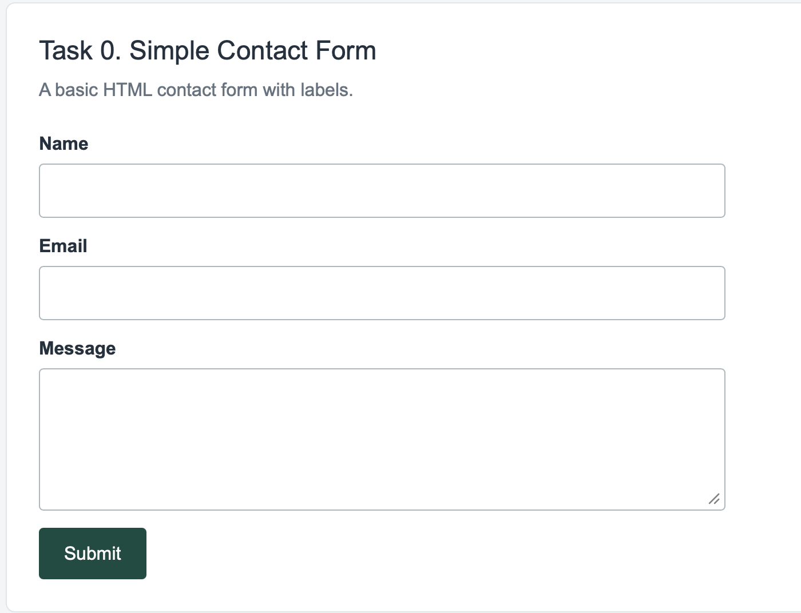
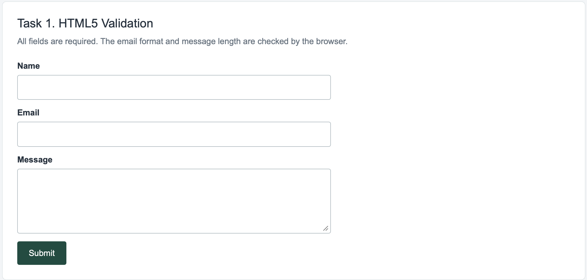
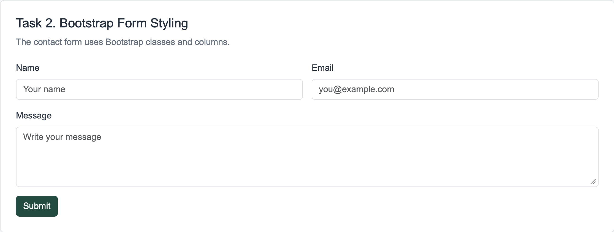
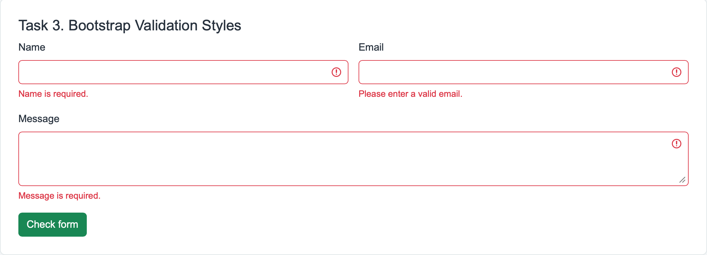
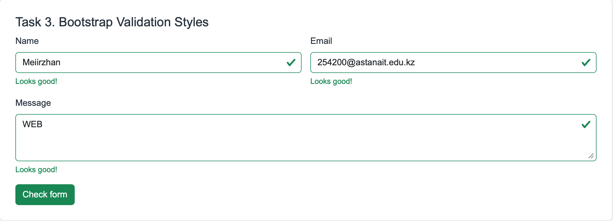
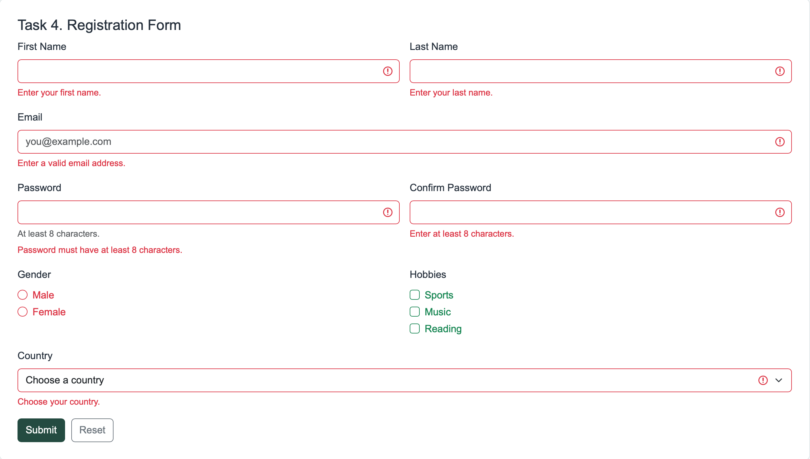
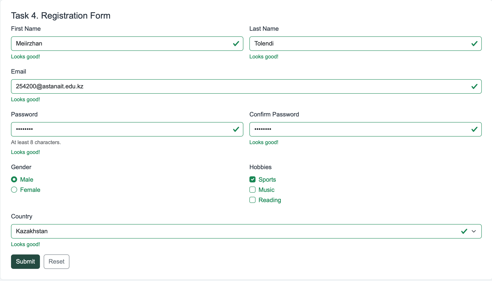
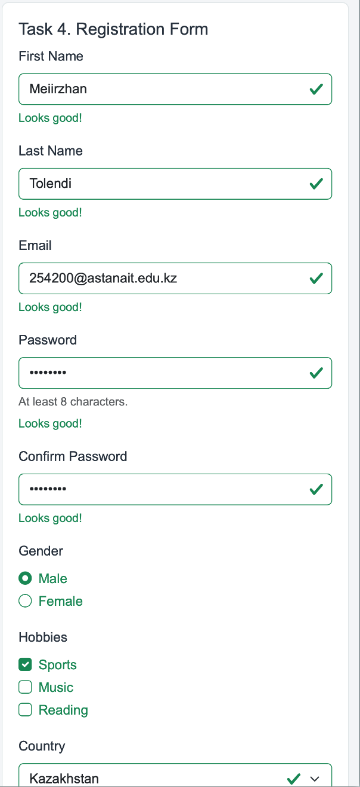

# Assignment 4. Forms and Validation

**Student:** Tolendi Meiirzhan  
**Group:** SE-2539  
**Course:** Web Technologies

## Part 1. Basic HTML Forms

### Task 0. Simple Contact Form
I made a simple contact form with Name, Email, Message and Submit fields. Each input has a label.

### Task 1. HTML5 Validation
I added `required`, `type="email"`, `minlength` and `maxlength`. The browser checks empty fields, email format and message length.

## Part 2. Bootstrap Forms

### Task 2. Bootstrap Form Styling
I made the contact form again using `form-control`, `form-label`, `row`, `col-12` and `col-md-6`. I also added placeholders and helper text.

### Task 3. Bootstrap Validation Styles
I used Bootstrap validation styling with `was-validated`, `valid-feedback` and `invalid-feedback`. The browser checks the required fields and shows feedback. Bootstrap uses the same colors as `is-valid` and `is-invalid`.

## Part 3. Advanced Form Project

### Task 4. Registration Form
I made a registration form with First Name, Last Name, Email, Password, Confirm Password, Gender, Hobbies and Country. I added Submit and Reset buttons. Bootstrap columns change the layout for smaller screens. Each password field requires at least 8 characters. Comparing the two passwords would need JavaScript or server-side validation, so it is not included.

## Work Process
First, I created the basic forms using HTML. After that, I added HTML5 validation. Then I used Bootstrap classes to style the contact form and added validation feedback messages. Finally, I made the registration form and used HTML5 validation and Bootstrap feedback styles for the registration form.

## Testing
I checked the forms with empty and correct values. I also tested incorrect email formats, short passwords, the Reset button and the mobile layout. These are demonstration forms with no server-side processing. The browser handles HTML5 validation.

## Project Files
- `index.html` contains all five tasks.
- `style.css` contains the page styles and mobile adjustments.
- `screenshots/` contains screenshots for each task.

